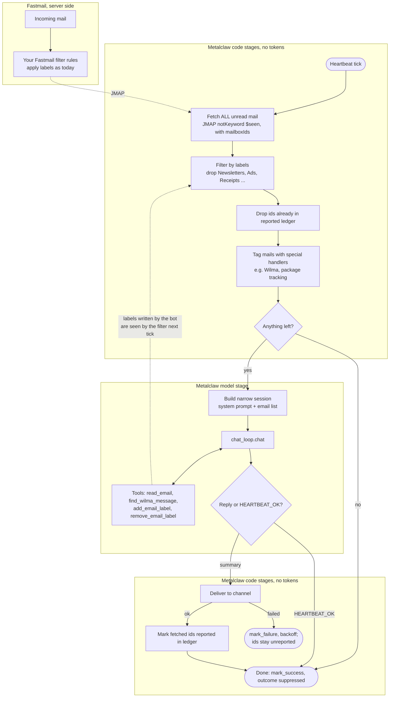

# Plan: code-first mail pipeline

Status (2026-10-21): design only, nothing implemented.

Goal: invert the heartbeat mail check so code drives the loop and the model runs only on what survives deterministic filtering. Fastmail labels (applied by the user's existing server-side rules) are the filter point; the bot fetches **all** unread mail and drops labelled-away mail in code. Unread-only is deliberate: mail already read elsewhere is never reported. The model's own `add_email_label` / `remove_email_label` calls feed the same filter on the next tick.

Because every stage except the model call is plain API traffic, the tick can run often (e.g. every 5 min). Later upgrades behind the same fetch stage: JMAP `Email/queryChanges` with a state token, then JMAP push (EventSource) instead of polling. A short quiet period in the fetch stage keeps bursts of mail in one summary.

Related: `heartbeat.md` (scheduler, backoff, `heartbeat_state.meta`), `fastmail-jmap.md`, `tools/mail.py:check_new_mail` (already does ledger + hint tagging; the hint field is the generic per-handler hook).

## Stages

| Stage | Owner | Notes |
|-------|-------|-------|
| Fetch | code | All unread, every mailbox except trash/junk/drafts/sent, with `mailboxIds`. One JMAP call. |
| Label filter | code | Deny-list of label names from config (resolved to ids via `_fm_lookup_mailbox`). Set intersection, no second request. Log dropped ids + rule at DEBUG; counts into `heartbeat_state.meta`. |
| Ledger | code | Existing `mail_reported.sqlite3`. |
| Handlers | code | Match sender/subject → attach `hint` naming the tool that fetches full content. Wilma exists; shipping notifications next. |
| Short-circuit | code | Empty residue → `mark_success(outcome=suppressed)`, zero tokens. |
| Model | LLM | Scope-less `Session`, narrow system prompt, narrow tool set, one `chat_loop.chat()` call. `HEARTBEAT_OK` or a summary. |
| Deliver | code | Existing channel routing. |
| Mark reported | code | Only after a successful send. Failed send → `mark_failure`, ids stay unreported, backoff as today. The model no longer calls `mark_emails_reported`. |

## Open points

- Where the pipeline hangs off the scheduler: a new heartbeat action `kind` naming a Python pipeline instead of a prompt, reusing ledger/state/backoff/channel routing unchanged.
- Config shape for the label deny-list (`mail_ignore_labels: [...]`).
- Burst batching window (fetch-stage quiet period) vs. latency.
