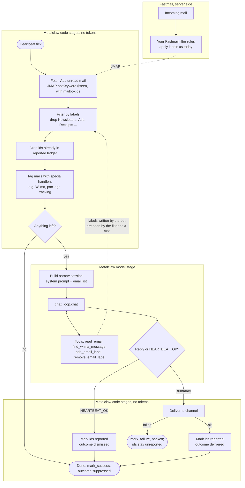

# Plan: code-first mail pipeline

Status (2026-10-21): **implemented** as designed — `pipelines/` package, `history.reported_items` + `pipeline_runs`, `heartbeat_pipelines` config, `/status` pipeline block; see `pipelines.md` for the as-built reference. This file keeps the rationale, the build-vs-buy decision and the test list. Not yet done: JMAP `queryChanges`/push, server-side `inMailboxOtherThan` for the deny-list, burst batching, `dismissed` expiry, `pipeline_runs` retention.

Goal: invert the heartbeat mail check so code drives the loop and the model runs only on what survives deterministic filtering. Fastmail labels (applied by the user's existing server-side rules) are the filter point; the bot fetches **all** unread mail and drops labelled-away mail in code. Unread-only is deliberate: mail already read elsewhere is never reported. The model's own `add_email_label` / `remove_email_label` calls feed the same filter on the next tick.

Because every stage except the model call is plain API traffic, the tick can run often (e.g. every 5 min). Later upgrades behind the same fetch stage: JMAP `Email/queryChanges` with a state token, then JMAP push (EventSource) instead of polling. A short quiet period in the fetch stage keeps bursts of mail in one summary.

The same shape — cheap poll, deterministic filters, model only when something is left, deliver, acknowledge — is what every future "watcher" integration (Wilma, GitHub notifications, package tracking, calendar) will want. The plan therefore separates the mail-specific steps from the shared ones, but deliberately does **not** build a generic workflow engine.

Related: `heartbeat.md` (scheduler, backoff, `heartbeat_state.meta`), `fastmail-jmap.md`, `tools/mail.py:check_new_mail` (already does ledger + hint tagging; the hint field is the generic per-handler hook).



## Design: plain functions, shared context, existing runner

Three concerns, kept apart:

| Concern | Lives in | Responsibility |
|---------|----------|----------------|
| Pipeline | `pipelines/mail.py` (one module per source) | An ordinary `async def run(ctx) -> Outcome` that calls the steps in order. Branching is `if`/`return`, nothing else. |
| Runner | `heartbeat.py`, unchanged in spirit | Scheduling (`at`/`cron`/`every`), backoff, single-flight, channel routing, `heartbeat_state`. |
| Context | `pipelines/context.py` | A small dataclass handed to every pipeline: config, ledger (shared, keyed by `source`, see "Ledger"), channel/scope, `now`, a `chat` callable, and a `trace` handle (see "Execution tracing"). |

A pipeline is readable top to bottom:

```python
async def run(ctx: PipelineContext) -> Outcome:
    heads = await fetch_unread_heads(
        ctx
    )  # mail-specific: ids + mailboxIds only, uncapped
    heads = drop_labelled(heads, ctx.config)  # mail-specific
    heads = ctx.ledger.drop_reported("mail", heads)  # shared
    if not heads:
        return Outcome.SUPPRESSED  # zero tokens
    heads = heads[:MAX_BATCH]  # cap AFTER filtering, oldest first
    emails = await fetch_bodies(
        ctx, heads
    )  # mail-specific: full properties for the residue only
    emails = attach_handler_hints(emails)  # mail-specific (hint field is shared)
    reply = await ctx.ask_model(
        system=MAIL_SYSTEM, items=emails, tools=MAIL_TOOLS
    )  # shared
    if reply.is_ok_sentinel:
        ctx.ledger.mark("mail", emails, outcome="dismissed")
        return Outcome.DISMISSED
    await ctx.deliver(reply.text)  # shared; raises on failure
    ctx.ledger.mark("mail", emails, outcome="delivered")
    return Outcome.DELIVERED
```

Shared steps are plain functions reused by composition (`ledger.drop_reported`, `ask_model`, `deliver`, `ledger.mark`). Source-specific steps are plain functions too. No registry of steps, no graph declaration, no DSL. A second pipeline (Wilma, GitHub) copies this shape and swaps the source-specific functions.

### Why no workflow library

Evaluated: Burr, pydantic-graph, llama-index workflows, LangGraph. All of them would work; pydantic-graph and Burr are light enough dependency-wise. Rejected for now because every flow in sight is linear with one or two branches, so a graph buys typed state and a picture, not control flow that `if`/`return` cannot express. Reconsider when one of these actually appears:

- durable mid-run resumption (continue from step N after a crash instead of re-running the cheap stages),
- many parallel paths with joins or loops,
- human-in-the-loop pauses that resume hours later,
- a need to browse historical runs and intermediate state in a UI (Burr's tracker).

Burr actions are plain functions, so the step functions above port without rewriting if that day comes. Until then, record enough trace data to get Burr's practical debugging value without its programming model.

### Hooking into the scheduler

`ActionKind` is the *schedule* type (`at` / `cron` / `every`) and stays as is. The hook is a new optional field on `HeartbeatAction`:

```yaml
- id: mail-watch
  kind: every
  every: 300
  pipeline: mail          # mutually exclusive with prompt
  channel: telegram-123
```

`_run_action` dispatches: `pipeline` set → look up `pipelines.REGISTRY[name]`, build a `PipelineContext`, `await run(ctx)`; otherwise the existing prompt path. `Outcome` maps onto the existing state calls: `SUPPRESSED` / `DISMISSED` / `DELIVERED` → `mark_success(outcome=...)` (counts and dropped-by-rule tallies go into `heartbeat_state.meta`); a raised exception → `mark_failure`, backoff as today. `create_heartbeat_action` does not expose `pipeline`; pipeline actions are seeded from config (`heartbeat_pipelines:`) or by hand in the ledger for now.

## Stages

| Stage | Owner | Notes |
|-------|-------|-------|
| Fetch heads | code | All unread, every mailbox except trash/junk/drafts/sent, **uncapped**, oldest first. One JMAP HTTP request chaining `Email/query` → `Email/get` via `#ids`/`resultOf` as `_fetch_emails` does today, but `Email/get` asks only for `id`, `mailboxIds`, `receivedAt` (a few bytes per mail), so hundreds of unread mails are cheap. Page `Email/query` with `position` if the server's query limit is hit. The label filter and ledger need nothing more than this. Later optimisation: push the deny-list server-side with `inMailboxOtherThan` in the query filter. |
| Label filter | code | Deny-list of label names from config (resolved to ids via `_fm_lookup_mailbox`). Set intersection, no second request. Log dropped ids + rule at DEBUG; counts into `heartbeat_state.meta`. |
| Ledger | code | Shared `reported_items` table in `history.db` keyed by `(source, external_id)`; see "Ledger". |
| Handlers | code | Match sender/subject → attach `hint` naming the tool that fetches full content. Wilma exists; shipping notifications next. |
| Short-circuit | code | Empty residue → `Outcome.SUPPRESSED`, zero tokens. |
| Cap + fetch bodies | code | `MAX_BATCH` (50) limits what reaches the **model**, not what is fetched. Applied only after the label and ledger filters, oldest first, so a backlog of filtered-away or already-reported mail can never shadow newer mail (capping before the filters would refetch the same 50 ignored mails every tick and starve everything behind them). A second `Email/get` fetches full properties for the capped residue only. The residue is marked after the model stage, so the next tick advances past it. |
| Model | LLM | Scope-less `Session`, narrow system prompt, narrow tool set, one `chat_loop.chat()` call. `HEARTBEAT_OK` or a summary. The model no longer calls `mark_emails_reported` and the tool is not in its set. |
| Mark dismissed | code | `HEARTBEAT_OK` → every id that reached the model is marked `dismissed`. **Required**: the fetch is unread-only, so without this any unread-but-unremarkable mail would be re-sent to the model every tick, defeating the zero-token goal. (The current tool-driven check has the same gap: its prompt only asks to mark "ids actually included".) |
| Deliver | code | Existing channel routing. **At-least-once**: a send can succeed server-side and still raise client-side (timeout before the ack), in which case the ids stay unreported and the retry re-delivers. Occasional duplicates are accepted; exactly-once is explicitly out of scope. |
| Mark delivered | code | Only after a successful send. Failed send → `mark_failure`, ids stay unreported, backoff as today. |

Acknowledgment is **per batch**, not per email. `delivered` means "this id was in a batch whose summary was delivered", not "this id was individually mentioned"; `dismissed` means "this id was in a batch the model answered with `HEARTBEAT_OK`". Both are terminal for the filter. The distinction is kept only so a later `/usage`-style view can tell "the model saw it and shrugged" from "you were told"; per-id tracking is deliberately out of scope (see Open points).

## Ledger

The per-source ledger moves out of `mail_reported.sqlite3` into `history.db`, following the `heartbeat_state` / `known_chats` pattern (one shared locked connection, one-time import of the legacy file, renamed `.bak`):

| Column | Notes |
|--------|-------|
| `source` | `mail`, later `wilma`, `github`, `parcel`, … |
| `external_id` | the source's own id (JMAP email id, Wilma message id, …) |
| `outcome` | `delivered` / `dismissed` |
| `first_reported_at` | ISO-8601 |

Primary key `(source, external_id)`. `ledger.drop_reported(source, items)` and `ledger.mark(source, items, outcome)` are the only two operations, so every future watcher reuses the same table without any pipeline-level abstraction. `mark_emails_reported` (the tool) writes to the same table under `source="mail"` until the tool-driven check is retired.

## Execution tracing

Invest in this immediately; it is the cheapest substitute for a workflow library's observability. New table `pipeline_runs` in `history.db`:

| Column | Notes |
|--------|-------|
| `run_id` | uuid |
| `pipeline` | registry name |
| `action_id` | heartbeat action that triggered it |
| `started_at`, `finished_at` | ISO-8601 |
| `outcome` | `suppressed` / `dismissed` / `delivered` / `failed` |
| `error` | message if failed |
| `steps` | JSON list of `{name, ms, note}` — e.g. `fetch 420ms 17 items`, `labels 0ms dropped 12 (Newsletters 9, Receipts 3)`, `model 6100ms`. |

`ctx.trace.step(name)` is a context manager the pipeline wraps each call in; it only appends to an in-memory list. The **runner** (`_run_action`) persists the row in a `finally` block, so a pipeline that raises mid-step still leaves a `failed` row with the steps completed so far and the error. No tracing framework, no spans, no exporters: a table and a list. `/status` shows the last run per pipeline; `/heartbeat` output links outcome to run id.

## Tests to write

- **Starvation**: 200 unread heads where the oldest 150 are all labelled-away or already reported → the model receives the newest-surviving 50, not an empty batch.
- **Restart between deliver and mark**: simulate `deliver` succeeding and the process dying before `ledger.mark`. On the next tick the same batch is delivered again (duplicate accepted per at-least-once) and then marked; no id is lost and no row is half-written.
- **Quiet path marks**: `HEARTBEAT_OK` → every id in the batch is `dismissed` and absent from the next tick's residue.
- **Failed deliver**: `deliver` raises → `mark_failure`, no ledger rows, `pipeline_runs` row has `outcome=failed` with the steps up to `deliver`.

## Open points

- Config shape for the label deny-list (`mail_ignore_labels: [...]`) and for seeding pipeline actions (`heartbeat_pipelines:`).
- Burst batching window (fetch-stage quiet period) vs. latency.
- Whether `dismissed` should expire (e.g. re-surface a dismissed mail if it is still unread after N days) — default no.
- Retention for `pipeline_runs` (rows are small; prune at 90 days or leave).
- Per-id delivered/dismissed split: deferred. Batch marking is correct for the filter's purpose (every id that reached the model is terminal); if the split is wanted later, a trailing `INCLUDED: id, id` line parsed off the reply is the cheap route, structured output the expensive one.
