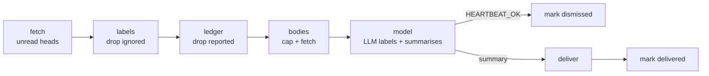
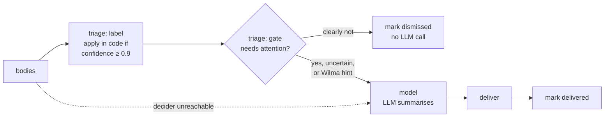
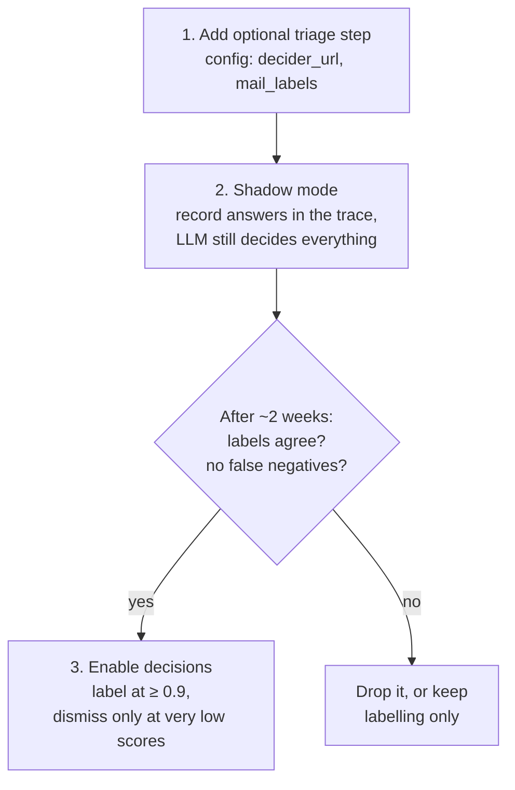

# Strands Decider as a mail triage stage

*Investigated 2026-11-10. Sources are listed at the end. The model was not run; everything here comes from the blog post, the repository and the model card.*

## Summary

Strands Decider cannot replace the mail pipeline, because it produces no text and the pipeline's output is a written summary. It does fit as a new **triage stage** between `bodies` and `model`: label every mail from a fixed set, and dismiss the clearly unimportant ones before the LLM sees them.

Recommendation: do not adopt it directly. Add it behind a config switch in **shadow mode**, measure it against what the LLM actually does on real mail for a couple of weeks, and only then let it make decisions.

## What Strands Decider is

A small open-source *decision model*. It picks between options and returns a confidence for each; it never generates free text.

| Property | Value |
|---|---|
| Base model | Qwen3.5-2B-Base, LM head removed |
| Head | Pointer head, about 1M parameters, plus a LoRA adapter on the torso |
| Size | 1.9 billion parameters |
| License | Apache-2.0 |
| Current checkpoint | `StrandsAgents/strands-decider-2B-qwen3.5-v1-2610` (first release 2026-10-09) |
| Context window | 4096 tokens |
| Latency (median) | About 115 ms on an RTX 3090, 153 ms on an M3 Pro. Serves on CPU, no timing given |
| Install | `pip install strands-decider` |

### Question types

| Type | Answers | Mail use |
|---|---|---|
| `noul` | A yes/no score between 0 and 1 | "Does this need the user's attention?" |
| `choice` | One of N options, with a probability per option | "Which label fits?" |
| `score` | A level on an ordered scale | Not needed |

Several questions about the same text are cheap: the text is read once and each question adds only its own tokens. One pass per mail can answer both "actionable?" and "which label?".

### HTTP API

```bash
strands-decider serve StrandsAgents/strands-decider-2B-qwen3.5-v1-2610 --port 8000
```

```bash
curl -s localhost:8000/v1/systemone -H 'content-type: application/json' -d '{
  "state": "Help! My payouts have been failing for 3 days!",
  "questions": {"is_urgent": {"type": "noul", "instructions": "Does this convey urgency?"}}
}'
```

```json
{
  "model": "strands-decider-2B-qwen3.5-v1-2610",
  "answers": {"is_urgent": {"type": "noul", "noul": 0.8581}},
  "usage": {"input_tokens": 86, "output_tokens": 1},
  "latency_ms": 489.01
}
```

The server binds to `127.0.0.1` and has no authentication. The response shape for `choice` and `score` is not documented; it has to be read off a running server.

## How it fits the mail pipeline

### Today



The LLM does three jobs in one call: choose a `bot/` label for every mail, decide what matters, and write the summary. Acknowledgement is per batch.

### With a triage stage



Both triage answers come from one decider call per mail; labelling and gating are independent decisions.

What changes:

- **Labels come from a fixed list in config.** This replaces the prompt logic that asks the model to call `list_email_labels` and reuse an existing `bot/` label, and stops near-duplicate labels appearing.
- **Dismissal becomes per mail.** Mail the decider is confident about never reaches the LLM.
- **The LLM keeps the summary.** It also keeps every mail the decider is unsure about, and all mail with a Wilma `hint`.
- **Failure is open.** If the decider is down, the whole batch goes to the LLM exactly as today.

### What it actually saves

| Setup | Saving |
|---|---|
| Local Ollama (the default) | No tokens to save. Some GPU time and latency on batches that are fully dismissed |
| Cloud model for the mail check | Real token savings on every dismissed mail |

The benefits that hold on any setup are the fixed label set and a calibrated confidence to put a threshold on.

## Risks

| Risk | Why it matters |
|---|---|
| **Finnish mail is unverified** | No language coverage is documented and the training mix is mostly English public datasets. Wilma and other Finnish mail is the most likely failure |
| **"Actionable" suits `noul` poorly** | The model card says `noul` and `score` "transfer poorly" to tasks unlike the training mix, and "actionable for this user" is exactly that |
| **Mail rules are weakly honoured** | The card says "questions are read less than documents". Putting `mail_pipeline_instructions` into the question will not work the way it does in an LLM prompt |
| **Thresholds are unproven here** | "Confidence ≥ 0.9 is right about 95% of the time" was measured on short classification only. The card says to measure on your own traffic. A false negative is a silently dropped important mail |
| **Heavy dependencies** | `torch`, `transformers>=5.15`, `peft`, `fastapi`. `requires-python >=3.10`; Python 3.14 is not confirmed. It must run as a sidecar, not as a metalclaw dependency |
| **Deployment friction** | Roughly 4 GB of memory in bf16 (an estimate from the parameter count), next to Ollama. The loopback-only bind is awkward under `compose.yaml` |
| **Young project** | About 50 commits, no tagged releases, parts of the HTTP API undocumented |

## Recommended rollout



1. **Add the step, off by default.** It needs two config fields: `decider_url` and a `mail_labels` list. Metalclaw calls the sidecar over `httpx`; no new Python dependencies.
2. **Shadow mode.** The decider answers for every mail, and the answers go into the pipeline trace next to what the LLM did. The LLM's own label and its deliver/dismiss outcome are the ground truth.
3. **Evaluate.** Check label agreement, and look hard at false negatives: mail the decider would have dismissed that the LLM reported. Split the numbers by language.
4. **Enable decisions** only if the numbers hold. Apply labels in code at confidence ≥ 0.9. Dismiss only at very low "actionable" scores. Everything else, and all Wilma-hinted mail, still goes to the LLM.

### Baseline to compare in the same shadow run

A per-mail structured-output call to the existing Ollama model, asking the same two questions. It needs no new dependencies or sidecar. The decider's advantages over it are calibrated confidence and speed; if the shadow run shows neither matters in practice, the baseline is the simpler choice.

## Open questions

- Does it handle Finnish mail acceptably?
- What does the HTTP response look like for `choice`?
- Does `torch` plus `transformers>=5.15` install cleanly where the sidecar would run?
- How much memory does the 2B model really use, and can it share the GPU with Ollama?
- Is a fine-tune on our own labelled mail worth it? The repo ships training scripts and a customisation guide; a full training run is about 11 hours on one RTX 3090.

## Sources

- [Introducing Strands Decider (blog post)](https://strandsagents.com/blog/introducing-strands-decider/)
- [strands-labs/strands-decider (code, README, `pyproject.toml`)](https://github.com/strands-labs/strands-decider)
- [Model card: StrandsAgents/strands-decider-2B-qwen3.5-v1-2610](https://huggingface.co/StrandsAgents/strands-decider-2B-qwen3.5-v1-2610)
- Current pipeline: `pipelines/mail.py`, `ai-docs/pipelines.md`
